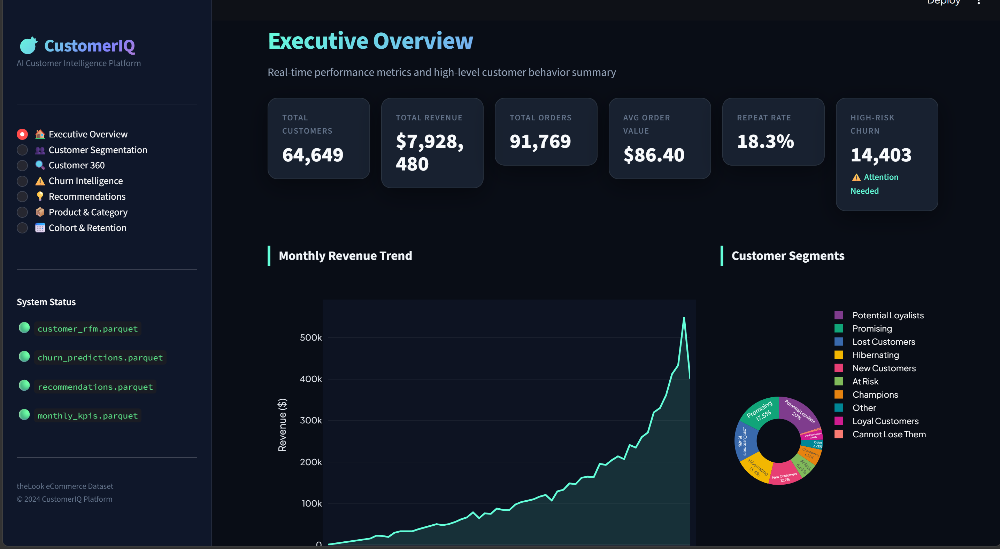
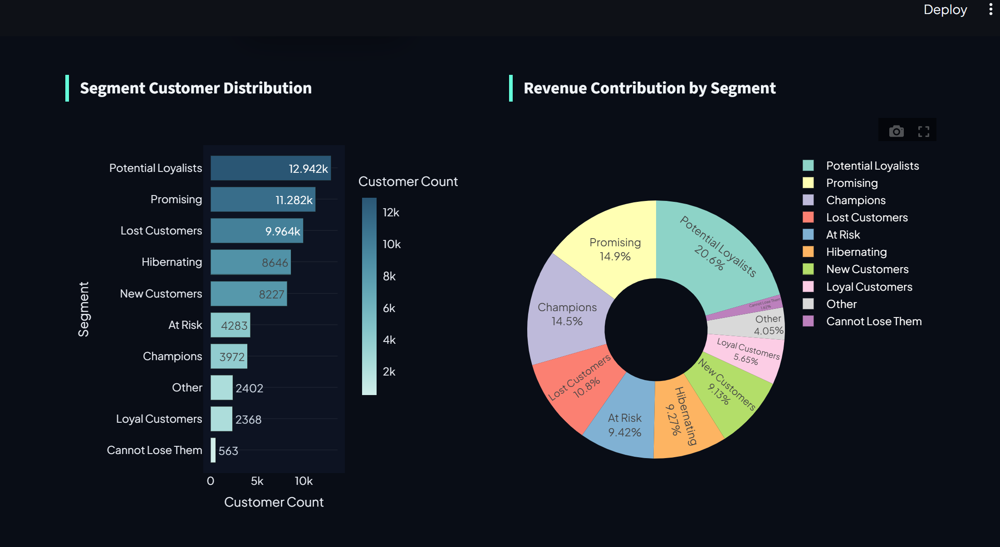
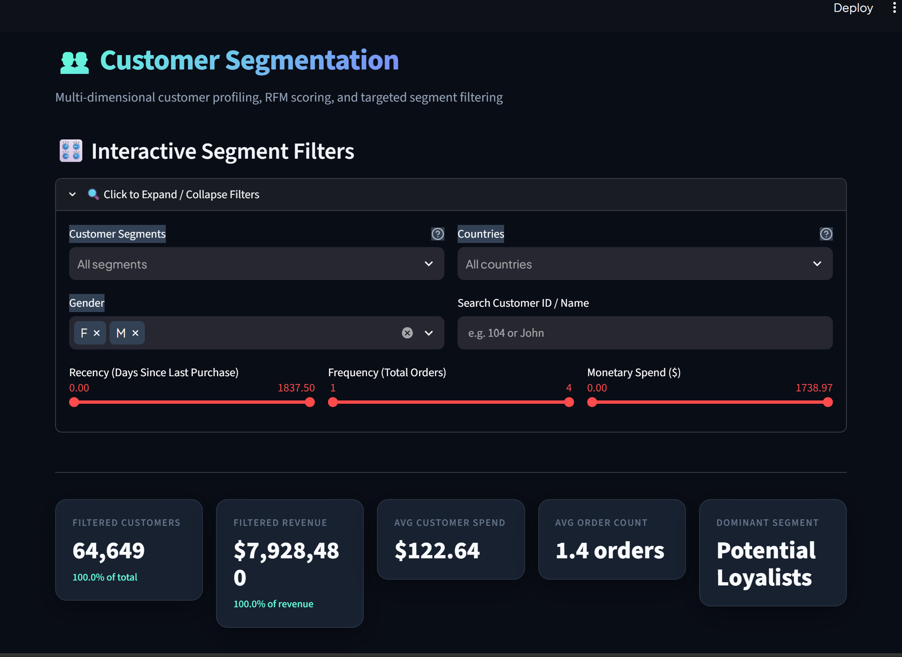
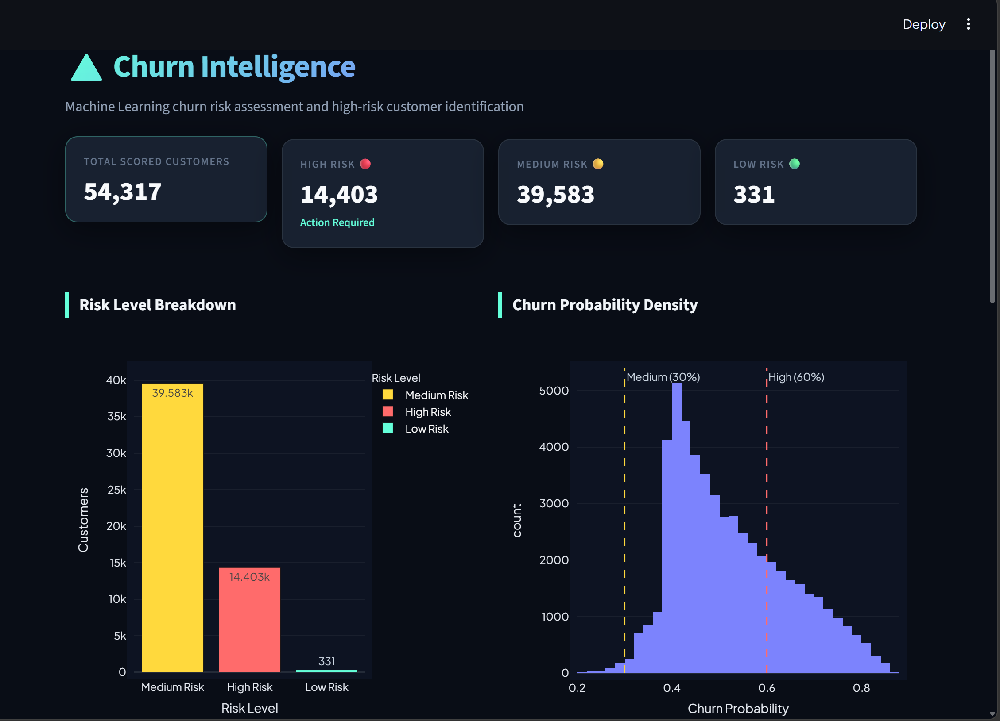

# CustomerIQ

**Batch customer analytics and Streamlit dashboard portfolio project**

🔗 **[Streamlit dashboard URL](https://customeriq-dashboard.streamlit.app/)**

---

## Overview

CustomerIQ is a portfolio project built on the **theLook eCommerce dataset**. It transforms raw e-commerce tables into customer analytics through:

- Rule-based customer segmentation using RFM scores
- Churn prediction (Logistic Regression + Random Forest)
- Segment-level product popularity recommendations
- Customer lifetime value estimation
- Cohort & retention analysis
- Monthly KPI tracking
- Category performance analytics
- An interactive Streamlit dashboard

---

## Problem Statement

Modern e-commerce businesses generate enormous volumes of customer data but struggle to extract actionable intelligence from it. CustomerIQ addresses this by providing:

1. **Who are my best customers?** → RFM segmentation
2. **Which customers are about to churn?** → ML churn prediction
3. **What should I recommend to each customer?** → Segment-level product popularity recommendations
4. **How much is each customer worth?** → CLV estimation
5. **Are my cohorts retaining well?** → Cohort analysis

---

## Business Objectives

- Reduce customer churn by identifying at-risk customers early
- Increase revenue through personalised recommendations
- Optimise marketing spend by targeting the right segments
- Track business health through monthly KPIs
- Understand product and category performance

---

## Features

| Feature | Description |
|---------|-------------|
| 🔍 RFM Analysis | Recency, Frequency, Monetary scoring per purchasing customer |
| 👥 Segmentation | Nine documented business rules applied to RFM scores |
| 🤖 Churn Prediction | Binary classification probabilities and configured risk bands |
| 💡 Recommendations | Segment-level product popularity with explanations |
| 💰 CLV Estimation | Historical average basket value × estimated annual order frequency × horizon |
| 📅 Cohort Analysis | Retention matrix by acquisition cohort |
| 📊 KPI Dashboard | Monthly revenue, orders, new/repeat customers |
| 📦 Category Analytics | Revenue, order count, customer reach, and product count by category |
| 🔮 Customer 360 | Full customer profile in one view |

---

## Architecture

```
Raw Tables (CSV/Parquet)
    ↓
Data Loader → Data Validator → Preprocessing
    ↓
DuckDB table load + Pandas feature engineering
    ↓
RFM → Rule Segmentation → CLV
    ↓
Churn Features → ML Training → Predictions
    ↓
Segment Popularity Recommendations → Cohorts → Monthly KPIs → Category Analytics
    ↓
Output Parquet Files (data/output/)
    ↓
Streamlit Dashboard (dashboard/app.py)
```

---

## Data Flow

1. Raw CSV/Parquet files are loaded from `data/raw/`
2. Validation checks required columns, non-empty tables, and referential integrity
3. Preprocessing parses dates and removes or normalizes invalid values with log messages
4. Cleaned tables are loaded into DuckDB; main pipeline analytics use Pandas functions
5. Feature engineering builds customer-level aggregates
6. Rule-based segmentation assigns RFM scores and business labels
7. Churn models use historical features and a bounded future label window
8. Recommendations rank segment-level popularity among unpurchased products
9. Outputs are staged, schema-checked, and published as Parquet
10. The Streamlit dashboard reads from `data/output/`

The SQL files provide separate query examples. They are not the execution path for
the main pipeline; `scripts/generate_outputs.py` only regenerates monthly KPIs and
category analytics from DuckDB. The per-product analytics function is not currently
published as an artifact or displayed by the dashboard. KMeans is an optional helper
in `src/segmentation.py` and is not called by the pipeline or dashboard.

---

## Dataset

**theLook eCommerce** — synthetic e-commerce dataset from Google (BigQuery Public Data).

| Table | Description |
|-------|-------------|
| `users` | Customer profiles (demographics) |
| `orders` | Order headers (status, date) |
| `order_items` | Line items with sale_price |
| `products` | Product catalog (category, brand, price) |
| `events` | Clickstream events |
| `inventory_items` | Inventory and cost |
| `distribution_centers` | Warehouse locations |

See `data/raw/README.md` for download instructions.

---

## Technology Stack

| Technology | Purpose |
|-----------|---------|
| Python 3.10+ | Core language |
| Pandas | Data manipulation |
| NumPy | Numerical computing |
| DuckDB | In-process analytical SQL |
| PyArrow | Parquet I/O |
| Scikit-learn | ML models, preprocessing, evaluation |
| Joblib | Model persistence |
| Streamlit | Interactive dashboard |
| Plotly | Interactive visualisations |
| Pytest | Testing |

---

## Project Structure

```
CustomerIQ/
│
├── data/
│   ├── raw/           ← Place theLook dataset files here
│   │   └── README.md  ← Download instructions
│   ├── processed/     ← Optional intermediate data (not currently produced)
│   └── output/        ← Final analytics outputs (Parquet)
│
├── database/
│   └── customeriq.duckdb   ← Auto-created analytical database
│
├── src/
│   ├── config.py           ← All paths, parameters, constants
│   ├── data_loader.py      ← CSV/Parquet auto-detection
│   ├── data_validator.py   ← Pre-analytics data quality checks
│   ├── preprocessing.py    ← Cleaning and normalisation
│   ├── duckdb_manager.py   ← DuckDB connection and query execution
│   ├── feature_engineering.py  ← RFM, churn, customer aggregates
│   ├── segmentation.py     ← RFM scoring, rules, CLV, optional KMeans helper
│   ├── churn.py            ← Churn model training and predictions
│   ├── recommendation.py   ← Segment-level popularity recommendations
│   ├── analytics.py        ← Monthly KPIs, cohorts, product analytics
│   └── utils.py            ← Logging, Parquet I/O, timing
│
├── sql/
│   ├── rfm.sql
│   ├── cohort.sql
│   ├── monthly_kpis.sql
│   └── category_analytics.sql
│
├── dashboard/
│   └── app.py              ← Streamlit dashboard (7 pages)
│
├── models/                 ← Trained ML model artifacts
│
├── tests/
│   ├── test_data_validation.py
│   ├── test_rfm.py
│   ├── test_segmentation.py
│   ├── test_churn.py
│   ├── test_recommendations.py
│   ├── test_artifacts.py
│   ├── test_duckdb_manager.py
│   └── test_sql.py
│
├── scripts/
│   ├── generate_outputs.py   ← Regenerates two SQL-backed analytics files
│   └── test_pipeline_execution.py ← Isolated end-to-end test
│
├── run_pipeline.py         ← Main pipeline entry point
├── requirements.txt
├── docs/INTERVIEW_GUIDE.md
├── .gitignore
├── LICENSE
└── README.md
```

---

## Installation

### 1. Create a virtual environment

```bash
cd CustomerIQ
python -m venv venv
```

### 2. Activate the virtual environment

**Windows:**
```bash
venv\Scripts\activate
```

**macOS/Linux:**
```bash
source venv/bin/activate
```

### 3. Install dependencies

```bash
pip install -r requirements.txt
```

---

## Dataset Setup

1. Follow the instructions in `data/raw/README.md`
2. Place the theLook eCommerce tables in `data/raw/`
3. Files can be `.parquet` (preferred) or `.csv`

---

## Running the Pipeline

```bash
python run_pipeline.py
```

The command reads source tables from `data/raw/`, loads cleaned tables into DuckDB,
trains both churn models, and writes the nine dashboard Parquet artifacts to
`data/output/`. Source tables are not included in Git. The reviewed processed
artifacts are included so the hosted dashboard can start without local files or a
visitor-run pipeline. A failed validation or model stage stops the run before the
output set is replaced.

Expected output:
```
============================================================
  CUSTOMERIQ PIPELINE
============================================================

[1/14] Validating dataset...
[2/14] Loading raw data...
[3/14] Cleaning data...
...
[14/14] Exporting outputs...

============================================================
  CUSTOMERIQ PIPELINE COMPLETED SUCCESSFULLY
============================================================
```

---

## Running the Dashboard

```bash
streamlit run dashboard/app.py
```

Navigate to `http://localhost:8501` in your browser.

The dashboard resolves paths from the repository location, so it can also be started
from another working directory. On startup, it checks that each published Parquet
artifact can be read. If outputs are missing and all seven approved raw tables are
available, it attempts the pipeline once for that app process. Otherwise, it shows a
maintainer-facing diagnostic; visitors do not need to run commands.

## Streamlit Community Cloud Deployment

For the existing public app, use these settings in Streamlit Community Cloud:

| Setting | Value |
|---|---|
| Repository | `AnkushSharma5/CustomerIQ` |
| Branch | `main` |
| App file | `dashboard/app.py` |
| Python | `3.12` (the Community Cloud default) |

Keep `requirements.txt` at the repository root. The nine reviewed files in
`data/output/` are required for the first deployment:

- `category_analytics.parquet`
- `churn_feature_importance.parquet`
- `churn_predictions.parquet`
- `cohort_retention.parquet`
- `customer_clv.parquet`
- `customer_rfm.parquet`
- `customer_segments.parquet`
- `monthly_kpis.parquet`
- `recommendations.parquet`

They total about 8.4 MB and are regenerated locally with `python run_pipeline.py`
after the source tables are installed. Raw files under `data/raw/`, the DuckDB
database, and model files remain excluded from Git. The Parquet files are processed
outputs from the public, fictitious theLook eCommerce dataset. In particular,
`customer_segments.parquet` includes synthetic profile fields; the regenerated file
was checked and every email domain is `example.com`, `example.net`, or `example.org`.
[Google describes theLook data as synthetic](https://partner.skills.google/focuses/80989?parent=catalog), but the repository's
MIT license applies to the project code, not to Google's source dataset or its data
terms.

After pushing a commit to `main`, Community Cloud should detect the GitHub update and
redeploy the app. Open [the public dashboard](https://customeriq-dashboard.streamlit.app/),
confirm the sidebar lists all nine artifacts as **Ready**, then visit each of the
seven sections and confirm its charts or customer views render. If the app shows an
old version, use **Manage app → Reboot** in Community Cloud and check its build logs.
The repository settings can be prepared here; the existing Community Cloud account
settings must be verified in that service.

---

## Running Tests

```bash
python -m pytest -q
```

The full test command includes unit tests and the end-to-end test in `scripts/`.
Tests use synthetic data and do **not** require the real dataset. The end-to-end test
runs in an isolated temporary project copy, so it does not overwrite local data,
models, DuckDB files, or checked-in artifacts.

---

## Machine Learning Methodology

### Churn Prediction

**Definition**: A customer is labelled "churned" if they had no completed order from
the feature cutoff through the end of the configured 90-day label horizon.

**Feature Window**: Completed orders strictly before the cutoff date.

**Label Window**: Completed orders from the cutoff through the configured horizon end.
The function rejects a cutoff when the available completed-order history does not
cover the full horizon. Only customers with at least one historical completed order
are included.

The pipeline treats `complete`, `shipped`, and `processing` as purchase statuses;
other statuses such as `cancelled` and `returned` are excluded. Validate that
business definition for any different retailer or use case.

The 90-day horizon is a configurable project assumption, not a threshold validated
against a particular retailer's purchase cycle.

**Anti-leakage design**: Features use historical orders only; the label uses the
separate future window. Evaluation uses a reproducible stratified random split by
customer, not a time-based holdout.

**Models**:
- Logistic Regression (baseline, interpretable coefficients)
- Random Forest (stronger, feature importance)

**Model Selection**: ROC-AUC selects the model. Recall and other classification
metrics are reported, but no probability threshold is tuned to campaign costs.

**Validation**: Stratified 80/20 train/test split with fixed `random_state=42`.
Scaling is fitted on the training partition only. Metrics are logged during training
but are not persisted to dashboard artifacts. The published prediction file scores
the same historical cohort used for model fitting, so it is not evidence of
prospective campaign performance. Probability thresholds are configurable rules,
not calibrated or business-optimized cutoffs.

---

## RFM Methodology

| Metric | Definition |
|--------|-----------|
| Recency | Days since the customer's most recent completed purchase |
| Frequency | Number of distinct completed orders |
| Monetary | Total revenue contribution (sum of sale_price from completed items) |

Scores 1–5 are assigned using percentile ranks. Equal metric values share the same
score, so ties can result in fewer than five distinct scores:
- R score: 5 = most recent (lowest recency)
- F score: 5 = most frequent
- M score: 5 = highest spender

---

## Segmentation Methodology

The pipeline uses deterministic rules on R/F/M scores. The optional KMeans helper is
available in the source but is not included in pipeline outputs or the dashboard.

---

## CLV Formula

```
Estimated CLV = AOV × annual_purchase_frequency × horizon_years

where:
  AOV = average order value (historical)
  annual_purchase_frequency = total_orders / tenure_years
  horizon_years = 2.0 (configurable in src/config.py)
```

This is clearly labelled as an **estimate**. It is not a guaranteed future value.

---

## Recommendation Methodology

1. Identify each customer's purchased products.
2. For each customer's segment, rank products by item purchase count among peers.
3. Exclude purchased products and rank remaining candidates by normalized purchase
   count using a bounded candidate pool.
4. Every recommendation includes a human-readable explanation.
5. Backfill from overall item popularity when the segment candidate pool is sparse.

This is a segment-level popularity recommender, not a model trained on individual
preference vectors. The bounded candidate pool can return fewer than the requested
number when a customer has purchased the available top candidates.

---

## Risk Thresholds

| Risk Level | Churn Probability |
|-----------|-------------------|
| Low Risk 🟢 | < 30% |
| Medium Risk 🟡 | 30% – 60% |
| High Risk 🔴 | ≥ 60% |

Configurable in `src/config.py`.

---

## Evaluation Metrics

| Metric | Why Used |
|--------|---------|
| Accuracy | Overall correctness |
| Precision | Of predicted churners, how many actually churned |
| Recall | Of actual churners, how many were caught |
| F1-Score | Harmonic mean of precision and recall |
| ROC-AUC | Ranking quality across all thresholds |

---

## Screenshots

| Dashboard Overview | Segment Distribution & Revenue |
|---|---|
|  |  |

| Interactive Segment Filters | Churn Predictions |
|---|---|
|  |  |

*Run `streamlit run dashboard/app.py` to open the local dashboard.*

---

## Future Improvements

- Hyperparameter tuning (GridSearchCV / Optuna)
- Time-aware train/test split using `TimeSeriesSplit`
- More advanced recommendation algorithms (matrix factorisation)
- Prophet or ARIMA for revenue forecasting
- Customer journey analysis using event sequences
- Automated model retraining when new data arrives
- A/B test simulation for retention campaign ROI

---

## Interview Explanation Guide

See [docs/INTERVIEW_GUIDE.md](docs/INTERVIEW_GUIDE.md) for the current project
explanation, implementation details, limitations, and interview questions.

---

## License

MIT License — see [LICENSE](LICENSE)

The MIT license covers the repository code only. The source data and data-derived
artifacts retain the source dataset's applicable terms.

---

*Built with Python, Pandas, DuckDB, Scikit-learn, and Streamlit.*
